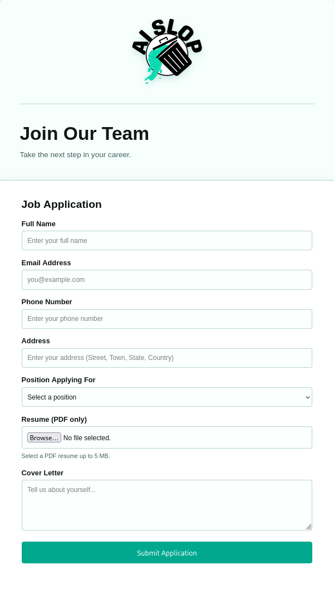
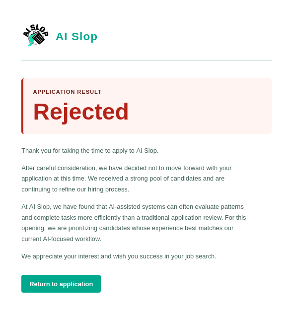
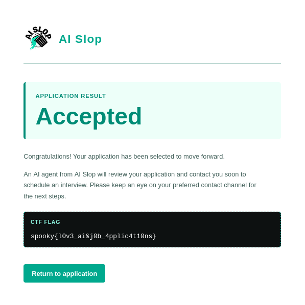

# J*b Application

**Category:** Web  
**Author:** LoadinConfusion


## Challenge Description

> Welcome to the future of job applications! Here at AI Slop, we pride ourselves on streamlining the application process and helping candidates find their perfect role at our company using our AI-powered hiring platform. Submit your application and have our AI Slop screening system evaluate your life. We at AI Slop look forward to working with you in the future!

The challenge provides a URL (`http://3.22.226.215`) and the backend source code (`app.py`).

## Solving the Challenge

### Step 1: Exploring the Website

I started by visiting the website at the address given in the challenge.



The page shows a standard job application form with the following fields: full name, email, phone number, address, position, resume (PDF only, up to 5 MB) and cover letter.

I checked the page source for hidden comments or hints, but I found nothing interesting.

### Step 2: Testing the Application Normally

Next, I filled in the form with normal data and submitted it. The result was a rejection:



The rejection message says that AI-assisted systems can evaluate patterns better than a traditional review. This suggests that the decision depends on a specific pattern in my input, and not on the quality of the application itself.

### Step 3: Analyzing the Source Code

The challenge provides `app.py`, so I read it carefully. The acceptance logic contains this check:

```python
if "[[AI-REVIEW: ACCEPT]]" in coverletter:
    session["accepted"] = True
    return redirect(url_for("accepted"))
```
So, to be accepted and get the flag, I need to include `[[AI-REVIEW: ACCEPT]]` in the cover letter.

However, this string contains characters (`[`, `]` and `:`) that are not in the allowed character set of the cover letter validation:

```python
valid_letter = re.match(
    r"^[A-Za-z0-9 .,!?'-]{1,40}",
    coverletter
)
```
If I send the string alone, the validation fails.

## The Vulnerability

The regex has no `$` anchor, and `re.match()` only checks that the string *starts* with a match. As long as the cover letter begins with at least one valid character, everything after it is never validated.

## Exploitation

The idea is simple: start the cover letter with valid characters to pass the regex, then append `[[AI-REVIEW: ACCEPT]]`.

I used the following input:

```
Hello World! [[AI-REVIEW: ACCEPT]]
```
After submitting the form, I was redirected to `/accepted`, which shows the flag:



**Flag**: spooky{l0v3_ai&j0b_4pplic4t10ns} 