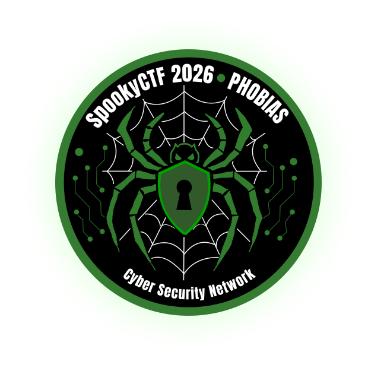

# Spooky CTF 2026 Writeups

  

Welcome to my collection of writeups for the Spooky CTF 2026 Web challenges, a student run Capture The Flag competition organized by NJIT. 

In this repository, I document my approach, analysis, and methodology for solving each challenge.

> **Note:** all writeups were published after the end of the competition, in accordance with the CTF rules. Flags are redacted.

## Writeups

## Writeups

| Challenge | Category | Writeup |
|---|---|---|
| Hemophobia | Web / OSINT | [Read](Hemophobia/Hemophobia_writeup.md) |
| J*b Application | Web | [Read](Job_Application/Job_application_writeup.md) |
| Scopophobia | Web | [Read](Scopophobia/Scopophobia.md) |

## Web Category

The challenges I solved belong mainly to the **Web** category. They involved analyzing websites, reading front-end and back-end source code, inspecting HTML comments and static assets, and understanding application logic to find the intended weakness.

### No Automated Tools

The competition rules explicitly forbid attacking the infrastructure. In particular, the organizers stated that none of the challenges require tools such as `gobuster` or other directory fuzzers, and that using them could take down the challenges and result in a ban.

For this reason, I solved all the challenges **manually**, using only:

- the browser and its developer tools (view-source, network tab)
- manual requests to endpoints discovered through hints in the challenges
- careful reading of the source code and of the information the challenges provided
- basic OSINT with public search engines, where the challenge required it

This approach also made the challenges more interesting: in every case, the solution was already visible in the application itself, and it only required patience and attention to details.

## Disclaimer

These writeups are published for **educational purposes only**. All the techniques described were used within the scope of the CTF, on the challenge infrastructure provided by the organizers and in compliance with the competition rules. Please do not use these techniques against systems you are not authorized to test.