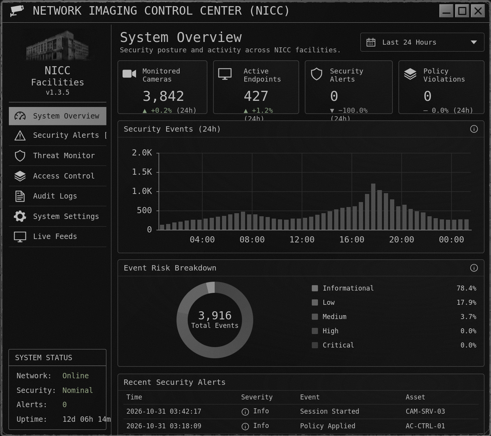
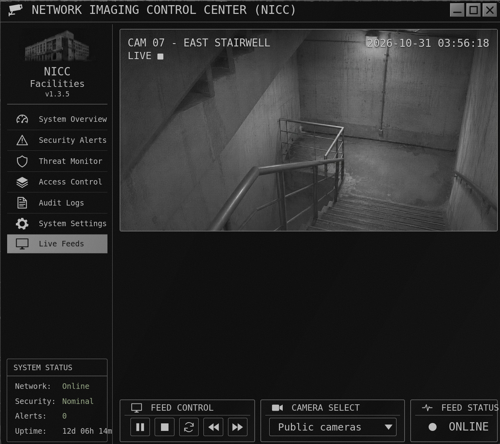
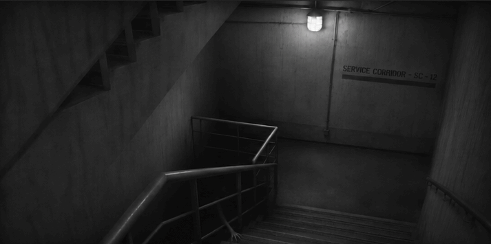
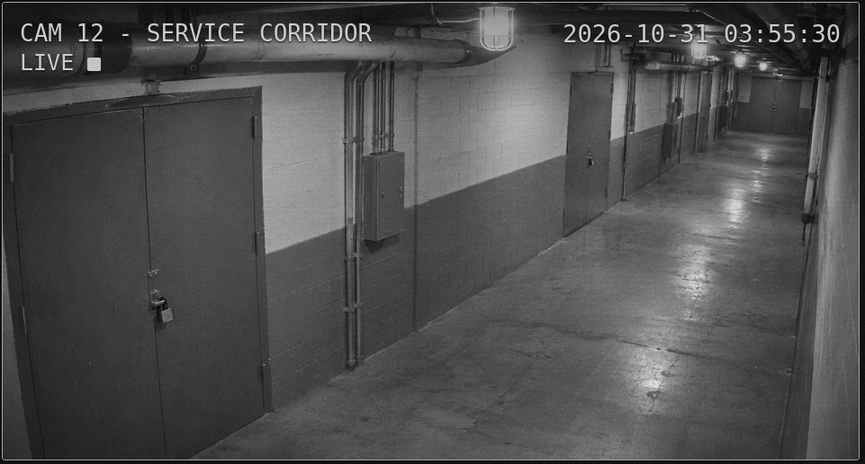
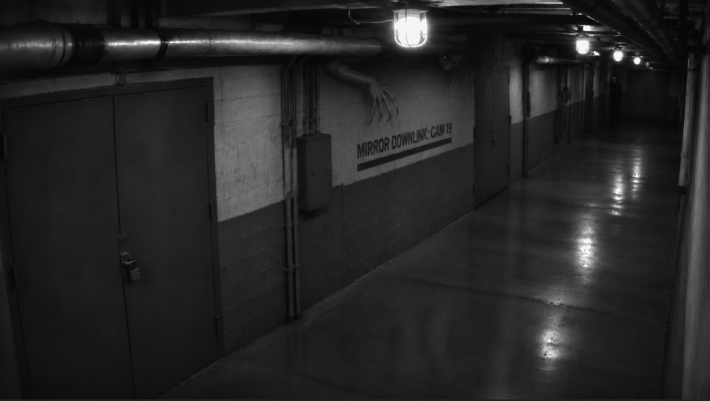
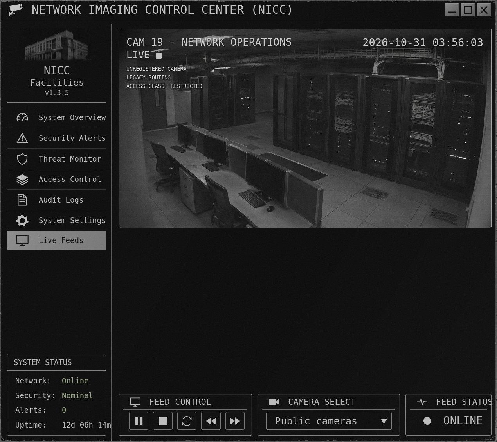
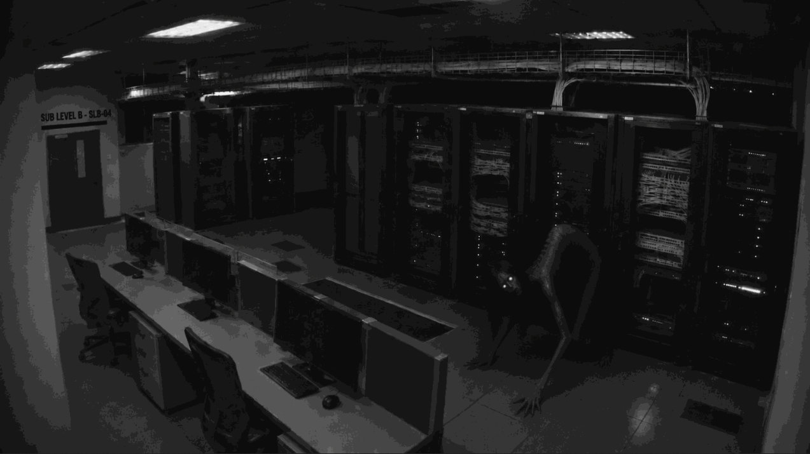
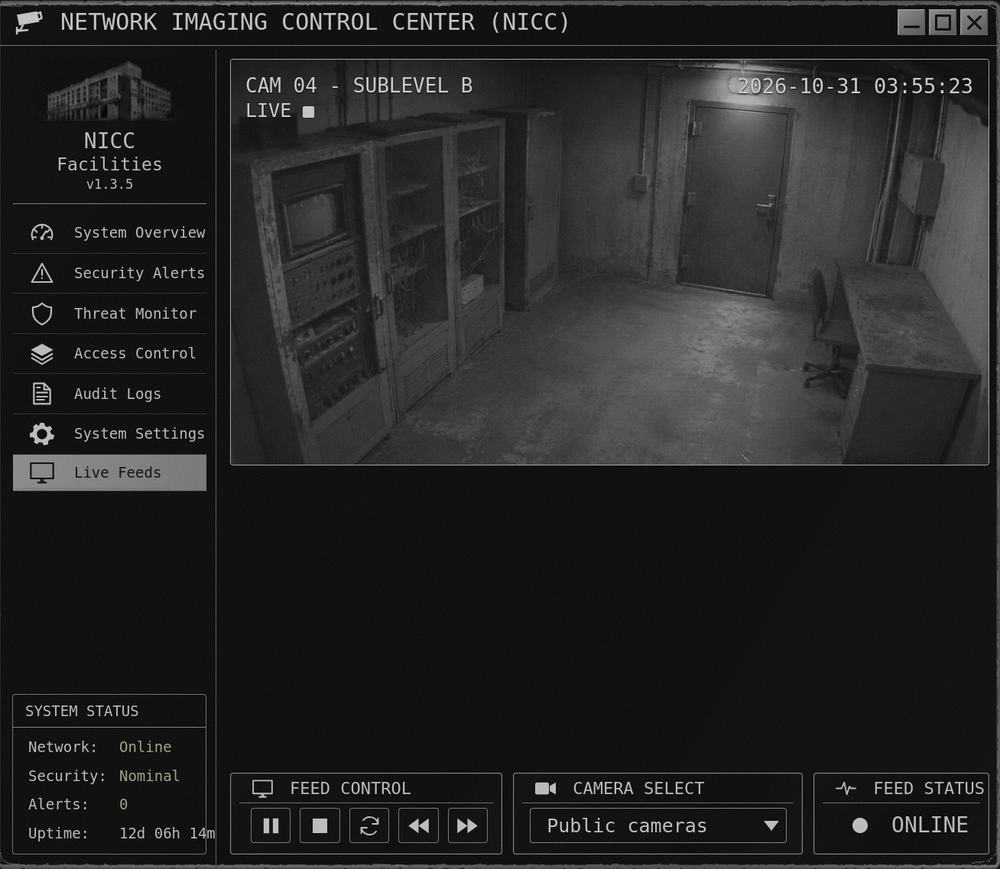
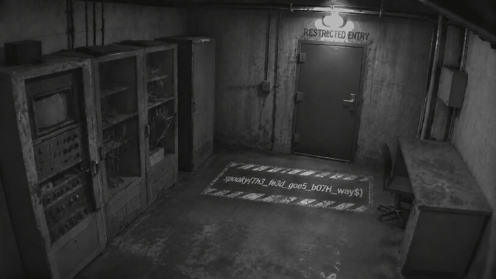

# Scopophobia

**Category:** Web   
**Author:** Sam Y.


## Challenge Description

> After months of unemployment, you finally land a big ol' j-o-b in security. It's minimum wage but hey, the experience is what matters. Though what they didn't tell you was the physical security aspect. Analyze the dashboard and read the source to try to find what they don't want you finding.

**Target:** `http://18.189.35.130/`

## Solving the Challenge

### Step 1: Exploring the Website

Visiting the target URL, I found a fake surveillance dashboard called the NICC (Network Imaging Control Center). The "System Overview" page shows the number of monitored cameras, a security events chart and a risk breakdown donut, all styled like a physical-security operations console.



I inspected `app.js` and found that all the numbers and charts on this page are purely cosmetic and generated client-side. There is no real backend data here, so the actual puzzle had to be elsewhere. The challenge description ("read the source") pointed me straight to the page source and the static assets.

### Step 2: Reading the HTML Source

Viewing the page source, I found three HTML comments left behind in production:

```html
<!-- NICC Imaging Migration Notes -->
<!-- TODO: Legacy camera inventory was excluded from the current monitoring migration.
Confirm whether archival feeds were properly retired. -->
<!-- CAM-07 was scheduled for decommissioning but remains registered. -->
```
These comments revealed two important things:

1. A "legacy" camera namespace exists and was never properly removed.
2. A camera numbered 07 is still reachable, even though it was marked for decommissioning.

In the HTML of the Live Feeds page, I also noticed that the camera `<select>` contained a disabled option:

```html
<option value="03" disabled>Legacy CAM 03</option>
```
Disabled on an HTML <option> is a purely cosmetic UI restriction, it does not protect the underlying URL in any way.

### Step 3: Analyzing `app.js` and `style.css`

While reading the JavaScript source (`app.js`), one comment stood out:

```js
// The final feed holds the cryptid frame until playback is reset.
const revealDelays = poster.hasAttribute('data-timed-reveal') ? [3500, Infinity] : null;
```
This showed me that some camera feeds can carry a `data-timed-reveal` attribute. When it is present, a two-frame GIF holds on the first frame for 3.5 seconds and then permanently switches to a hidden second frame. This was clearly designed to surface something that is not visible at first glance.

The stylesheet (`style.css`) confirmed the overall structure. It contained selectors such as `[data-feed="archive"]` and classes that did not appear in any of the HTML pages I had seen so far.

### Step 4: Finding the Legacy Camera (CAM-07)
I combined the "legacy" wording and the "CAM-07" reference from the comments with the path pattern of the existing public feeds (`/feeds/active/cam-01`). I then guessed the following path, which worked:

```
http://18.189.35.130/feeds/legacy/cam-07
```


The page shows **CAM 07 - EAST STAIRWELL**, and its source contains two more comments pointing further down the chain:

```html
<!-- Imaging migration record -->
<!-- Service camera directory: /feeds/service/ -->
```
The GIF behind the feed, available at `http://18.189.35.130/feeds/legacy/cam-07/frame`, shows a dark stairwell. After zooming in and enhancing the contrast, I could read a sign saying **"SERVICE CORRIDOR - SC-12"**.



### Step 5: Service Corridor (SC-12)

I combined the `/feeds/service/` namespace from the comment with the `sc-12` ID I read on the sign, which gave me the following path:

```
http://18.189.35.130/feeds/service/sc-12
```



The page shows **CAM 12 - Service Corridor**. Its source contained the next pair of comments:

```html
<!-- Service feed migration incomplete -->
<!-- Redundant imaging namespace: /feeds/mirror/ -->
```

The GIF at `http://18.189.35.130/feeds/service/sc-12/frame` shows a corridor with a wall marking that reads **"MIRROR DOWNLINK: CAM 19"**.



### Step 6: Mirror Downlink (CAM-19)

I used the `/feeds/mirror/` namespace together with the `cam-19` ID found in the previous frame:

```
http://18.189.35.130/feeds/mirror/cam-19
```



This page (**CAM 19 - Network Operations**) was the first to show a `<div class="ctf-diagnostics">` block in its source, which confirmed that I was getting close to something restricted:

```html
<div class="ctf-diagnostics">
  <span>UNREGISTERED CAMERA</span>
  <span>LEGACY ROUTING</span>
  <span>ACCESS CLASS: RESTRICTED</span>
</div>
```
Its HTML comments pointed to the final namespace, this time without stating the name explicitly:

```html
<!-- Restricted camera migration -->
<!-- Sublevel imaging uses a three-letter directory alongside the other feeds. -->
```

In the GIF frame of this camera, I read a sign saying **"SUB LEVEL B - SLB-04"**. Combined with the "three-letter directory" hint, this led me to the namespace `sub` (short for "sublevel") and the full ID `slb-04`.



### Step 7: Sub Level B (SLB-04) - The Final Feed

```
http://18.189.35.130/feeds/sub/slb-04
```



The page shows **CAM 04 - Sublevel B**. This is the end of the chain: an old server/storage room with a "RESTRICTED ENTRY" sign above a door. The animated frame, available at `http://18.189.35.130/feeds/sub/slb-04/frame`, reveals a message written on the floor:



After zooming in on the text written on the floor, I obtained the flag.

**Flag:** spooky{Th3_fe3d_goe5_b07H_way$}